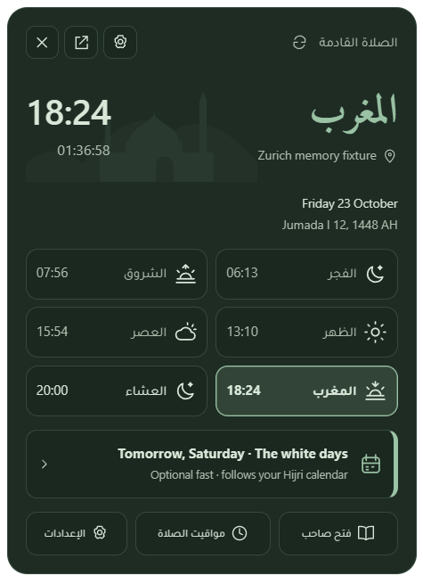
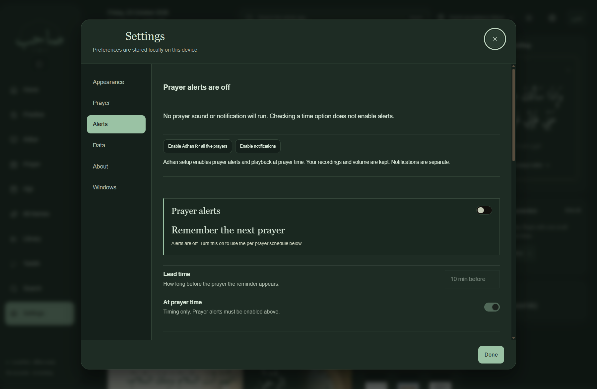
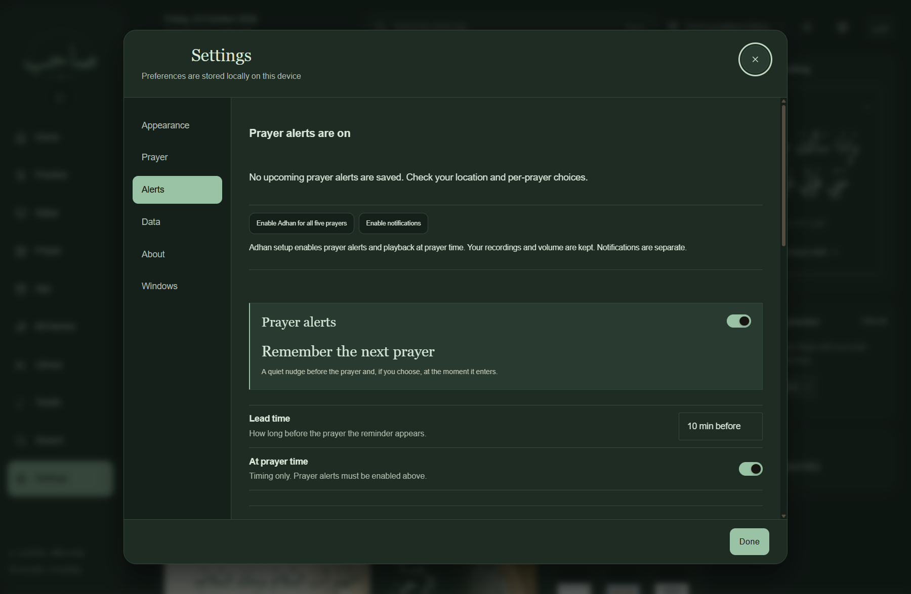

# Sahib Windows 0.2.3 — memory and widget verification

Tested on 23 October 2026 on `codex/windows-tauri`. The native compact widget and main-window unloading remain opt-in. The ordinary installer keeps the existing web widget. Nothing is merged into `main`.

## Decision

The best architecture to pursue is a native compact widget and Rust scheduler/tray/audio service, with Tauri windows created for the main interface and expanded panel only when needed. The prototype demonstrates a large memory reduction on this machine. It is not ready to become the default: native typography/accessibility, additional hardware scenarios and extended running still need review. Keep the existing implementation as the fallback.

Unloading only the main interface is a useful intermediate improvement, but the remaining web widget still carries a substantial browser cost.

## Repeatable comparison

Two rounds used fresh, isolated QA profiles with identical local prayer-provider settings, Zurich coordinates, disabled alerts and muted audio. Order was keep/unload/native, then native/unload/keep. Each state settled for ten seconds and requested a 30-second sample (about 36 seconds elapsed with process enumeration). The full main window was checked as visible. Compact samples required a real desktop point hit on the exact QA window; samples taken while the user's fullscreen game suppressed the primary widget were excluded and repeated.

The process profiler follows the entire descendant tree, including browser, renderer, GPU and utility processes, and records process identity, cumulative/per-interval CPU, working sets, private working sets and private committed bytes. CPU below is normalized across 16 logical processors. Working-set sums include shared pages more than once; private commitment is not resident RAM. These are debug QA measurements, not release benchmarks or direct equivalents of Task Manager's grouped number.

All memory values are MiB; ranges are the two observed rounds, not confidence intervals.

| Configuration | Main open working set | Main open private commit | Background working set | Background private working set | Background private commit | Background CPU | Background process count |
| --- | ---: | ---: | ---: | ---: | ---: | ---: | ---: |
| Main hidden + existing web widget | 624–646 | 485–503 | 589–632 | 224–266 | 421–452 | 0.286–0.352% | 8 |
| Main destroyed + existing web widget | 641 | 498–499 | 401–406 | 111.6–112.1 | 212.5–212.9 | 0.134–0.161% | 7 |
| Main destroyed + native compact widget | 556–571 | 468–477 | 43.0–43.8 | 6.8–7.5 | 9.3–10.3 | 0.008–0.011% | 1 |

Opening the full app in native mode still loads WebView2. Its lower main-open result also reflects the absence of a second web widget. Native compact mode has no Sahib-owned WebView2 descendants after retirement; the resident Tauri/Rust host remains.

| Configuration | Adapter-ready startup | Reopen main and check persistence |
| --- | ---: | ---: |
| Retained main | 0.76–1.48 s | 0.76–0.88 s |
| Destroyed main + web widget | 0.71–0.74 s | 1.11–1.23 s |
| Native compact + destroyed main | 0.73–0.75 s | 1.25–1.39 s |

Startup is spawn-to-adapter-ready on a warm machine, not a cold-start or input-to-photon measurement. Reopen includes QA readiness and persistence checks. Native compact-only cached restart was observed around 0.55 s with a 500 ms test-channel polling interval. Expanded panel creation/readiness took about 1.42 s in the final lifecycle run.

A later confirmation after opening rich interfaces, testing audio and closing them used 63.5 MiB working set, 13.5 MiB private working set and 20.0 MiB private commit at 0.022% normalized CPU, still one host process without WebView2. This higher post-interaction result is included so the fresh-process comparison is not mistaken for a permanent ceiling.

The two-round measurement binary SHA-256 was `613f07ba4b798856a7b822833655aa152aead467daba73b63ecd7f8517faa902`. A subsequent handshake fix addresses rapidly closing a recreated main window; the final lifecycle run confirms retirement and the post-interaction sample above. It does not replace the two-round measurements.

## Lifecycle and functionality

All six comparison runs preserved an IndexedDB record containing a Blob, local storage, the selected Adhkar category/view, local prayer provider, saved location and the exported future timetable. Recreated interfaces use the original profile and origin. No database names, storage keys or prayer calculations were changed.

The final native suite passed 30 checks: both physical monitors, actual point visibility, Start/Search, ordinary maximization, fullscreen and borderless suppression/recovery, deliberate Explorer taskbar promotion/recovery, auto-hide, tray registration and open callback, rapid close after tray reopening, on-demand expanded panel and its WebView retirement, standard/Fajr audio deadlines, notification-only practice deadline, audio stop, shared JavaScript timetable refresh, queued Settings action and compact-only restart.

An earlier actual Explorer restart run verified both native windows recovered against their own HWNDs after the shell rebuilt. That run exposed a separate rapid-close lifecycle failure, subsequently fixed and rerun in the final suite. The final suite did not restart Explorer again. Theme captures from that earlier run were affected by the installed widget overlapping the QA widget and are excluded from visual evidence.

The final main-window handshake waits for the frontend unload listener, so closing immediately after recreation cannot strand an unprepared hidden renderer. Opening during a background refresh cancels retirement and continues normal UI initialization. Late widget actions remain queued until listeners are attached.

An additional isolated check confirmed that an unfinished Adhkar editor retains the hidden main window; after the editor is closed, retirement resumes. Reader/session restoration paths are implemented, but reader pagination, active-session restoration and every unsaved dialog state were not comprehensively exercised. Navigation history is not reconstructed in full. These remain prototype limits.

Audio tests exercised actual native playback streams at zero volume, with the main window absent, and verified that Stop closes them. They do not prove audible output at the user's speakers. Notification calls and scheduler execution do not prove a visible banner through Windows notification policy or Focus Assist. Missed old Adhan playback policy remains unchanged.

## User-facing corrections

The installed profile was inspected read-only after the missed Dhuhr report: its native schedule contained zero enabled alerts. Selecting a timing option alone did not enable the master prayer-alert setting. The new desktop alert panel explicitly states when alerts are off, disables dependent timing controls and offers **Enable Adhan for all five prayers**. It preserves recording selections and volume. Notifications remain a separate explicit choice; personal preferences were not automatically enabled.

Start/Search sometimes covered an otherwise valid topmost widget. Both architectures now temporarily place the compact widget just above the taskbar when shell hit-testing demonstrates coverage during Start/Search, then restore its saved placement afterward. Fullscreen suppression takes precedence, preserving games/video immersion.

Enabled switches in the default Sahib dark theme now use an accent track and a contrasting on-accent thumb. The shared service-worker shell cache advances to `v2.14.3` for this CSS change; persistent book storage and IndexedDB are unchanged.

## Actual captures

Native captures below use a separate QA position and verify the captured HWND belongs to the QA process. They are real Windows GDI captures, not mockups. The expanded panel is the existing Tauri interface with staged QA prayer/reminder data.

## Remaining limits and complexity

Physical displays tested: primary 2560×1440 at 125%, and a 1920×1080 display at 100% to its left with negative coordinates. Physical 150%/200%, display hotplug, primary-display changes, virtual desktops, lock/unlock, actual sleep/resume, DST/clock/timezone changes and long-term unattended operation were not executed in this round. Controlled WinForms fullscreen/borderless fixtures do not establish compatibility with every game or DXGI fullscreen mode. The user's actual fullscreen game was observed suppressing the widget during early measurements.

The native prototype preserves the compact mosque/prayer/time/countdown/progress presentation, left-click panel, Settings action, dragging, monitor placement and supported palette families. It uses Segoe UI rather than all six bundled web fonts and does not yet provide equivalent UI Automation/keyboard accessibility. Palette parsing is limited; floating fallback styling needs further review. The rich panel retains existing web functionality and localization limits visible in the capture. Native mode does not promise zero WebViews while a rich view or unfinished editor is open.

Complexity: retaining the current widget is lowest; main unloading adds checkpointing, recreation and transient refresh coordination; native compact mode adds Windows painting/input/resources and accessibility maintenance. It reuses the same Rust host and authoritative schedule, with no second calculation engine, external service or Explorer injection. See [architecture and reproduction instructions](WINDOWS-MEMORY-ARCHITECTURE.md).

The verified default-preview checks are recorded below.

## Default preview verification

The standard build (without `native-widget-experiment`) passed **128/128** Windows acceptance checks with media and window reliability tests enabled. This includes navigation, native scheduling and restart persistence, standard/Fajr playback, the seven alert-setup checks, taskbar interactions and actual Start/Search visibility. The Sahib dark enabled-switch thumb/track passed a computed contrast ratio of at least 3:1. The Rust suite passed **13/13**, covering missed-alert policy, clock jumps/rollback, deduplication, notification suppression, simultaneous practice/prayer sounds, schedule replacement, taskbar geometry and decoding both recordings. Static release verification passed 57 application scripts, 82 HTML resources, 116 precache assets and both Adhan files.

Machine-readable evidence: [two-round process-tree samples](windows-0.2.3/memory-comparison.json), [final native checks and post-interaction sample](windows-0.2.3/native-verification.json), [actual Explorer restart checks](windows-0.2.3/explorer-restart-verification.json), [isolated visual/draft-retention checks](windows-0.2.3/native-visual-verification.json), and [default acceptance checks](windows-0.2.3/default-acceptance.json). Evidence records the pre-commit working tree, since verification precedes committing. QA profiles and browser data are not committed.

## Installer

The standard unsigned x64 NSIS installer built successfully: `Sahib_0.2.3_x64-setup.exe`, 23,301,743 bytes (22.22 MiB). SHA-256: `ab53df934ce2e44dc3641c9a207b4cff43f1efa191b14a925f5a415feec99d4e`. This installer uses the existing web widget; the native experiment is not included/enabled. It was built without the optional feature. It has not been installed over the user's existing application during this investigation. Acceptance uses the real Tauri debug QA app with a separate identity/profile; it is not an installer-upgrade test.
