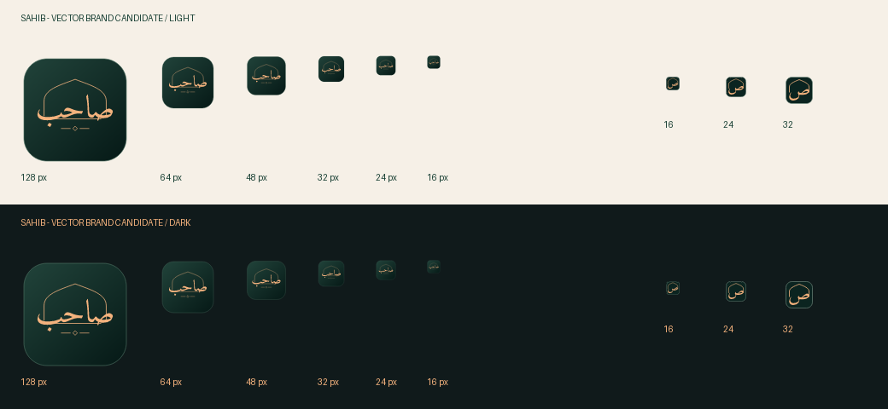
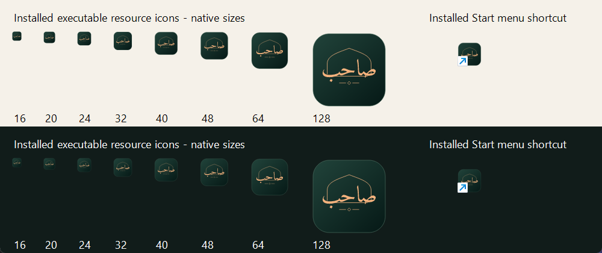

# Sahib 0.2.4 Windows release candidate

This work remains on `codex/windows-tauri`. The separate **Sahib RC** identity (`com.sahib.companion.rc`) enables the native compact widget by default. The ordinary build retains its WebView implementation. No merge to `main` or production branding replacement is approved yet.

## Architecture and memory

The compact widget uses a native HWND, GDI surfaces, DirectWrite text and UI Automation. Tauri remains the host, tray, scheduler and audio owner. The main application and expanded panel create WebView2 on demand. Closing safe rich views destroys their renderers; an active Adhkar session, open PDF, pending custom-audio import or unfinished edit intentionally retains its renderer. A warm shared JavaScript provider refreshes the authoritative timetable; Rust does not calculate a second prayer schedule.

One optimized release comparison on the same Windows machine, 16 logical processors, with visible taskbar widgets:

| Background configuration | Working set MiB | Private working set MiB | Private commit MiB | CPU, whole machine | Startup / reopen main |
|---|---:|---:|---:|---:|---:|
| Hidden main + WebView widget | 647.1 | 267.0 | 456.9 | 0.333% | 792 / 863 ms |
| Destroyed main + WebView widget | 416.4 | 116.4 | 217.3 | 0.142% | 813 / 1,135 ms |
| Native compact + destroyed rich views | 64.4 | 15.8 | 59.1 | 0.047% | 801 / 1,439 ms |

The corresponding full-window working sets were 651.1, 639.9 and 620.6 MiB. These are one-round observations, not guaranteed bounds. Summed working sets can count shared pages twice; private commit is not resident RAM. Sampling counts the host and all descendants and can miss a child that exits between samples. [Raw process-tree samples](windows-0.2.4/release-memory-comparison.json) include per-process CPU/private bytes/working sets. A legacy profiler label said “debug” despite the release invocation; the evidence copy explicitly corrects that label without changing sample values.

The actual installed RC2 (without QA hooks) subsequently averaged 65.2 MiB working set, 18.1 MiB private working set, 62.0 MiB private commit and 0.043% CPU over 36 seconds, with one host and no WebView2. Runtime debugging was enabled only for that isolated verification. These measurements precede the timer addition. A later short timer/style QA sample averaged 78.3 MiB working set, 18.2 MiB private working set, 61.5 MiB private commit and 0.028% CPU after the popup retired; this is not a controlled multi-round comparison.

A 619-second background soak observed no WebView2 at its end, mean working set 69.8 MiB and mean private commit 61.4 MiB. End commit was slightly below start. The machine was used during the soak; this is limited growth evidence, not a long-duration leak guarantee. [Soak samples and context](windows-0.2.4/background-soak.json).

The **final installed RC4**, after using the timer and English/Arabic rich views, averaged **84.5 MiB working set, 19.2 MiB private working set, 63.7 MiB private commit and 0.028% CPU** over 17.4 seconds. Every sample contained one host and no WebView2. An earlier short RC4 sample was about 71 MiB; working sets vary with resident shared pages. This is a short post-interaction sample, not a new controlled three-configuration benchmark. [Actual installed verification and samples](windows-0.2.4/installed-rc4-verification.json).

Recommendation: use the native compact renderer with on-demand rich views in the separate RC, retain compatibility mode, and keep protection for active work. The memory improvement is substantial, with higher implementation complexity: native text, accessibility and Win32 placement now need dedicated tests. Production promotion still requires icon approval and the remaining hardware checks.

## Arabic and accessibility

Audited existing Amiri, Cairo and Tajawal. Selected the existing **Tajawal Medium** face, decompressed to a 26,144-byte TTF, privately registered for DirectWrite. Latin/numeric labels use Segoe UI; clocks remain left-to-right in Arabic. Existing Amiri remains available in rich views for longer Arabic content. No additional Noto family is shipped.

| Native Arabic candidate | Font bytes | Working set MiB | Private commit MiB |
|---|---:|---:|---:|
| Bundled Tajawal Medium | 26,144 | 65.5 | 61.0 |
| Noto Sans Arabic, static comparison subset | 106,456 | 65.8 | 61.3 |
| Noto Naskh Arabic, static comparison subset | 109,168 | 65.6 | 60.9 |

Each short release sample lasted approximately 12 seconds; differences are within normal run variation. Tajawal fit the compact labels and existing interface without another family. Noto Naskh appeared smaller at compact dimensions. The Noto comparison subsets preserve shaping tables and are not packaged. [Font audit](windows-0.2.4/font-audit.json), [comparison](windows-0.2.4/font-comparison.json), [official candidate provenance](windows-0.2.4/noto-sources.jsonl). SIL OFL attribution is retained and bundled with the RC.

Actual desktop Arabic rendering was checked on the 125% primary and 100% secondary monitor with negative coordinates. Native offscreen text tests covered 100%, 125%, 150% and 200%, including diacritics and mixed text. Those are not physical 150%/200% display tests. DirectWrite reported zero failed draws in the final typography run. The compact widget exposes a localized UI Automation button/name/help/Invoke; Enter/Space opens the panel, F10 opens settings, and the tray can focus the widget. An external Windows UIA client verified the provider. Actual Narrator/NVDA listening remains untested.

## Daily reset, navigation and timer

- Daily Adhkar reset now clears both IndexedDB and live counters. Queued counter writes cannot resurrect the previous day. Date checks run on start/use/focus/visibility and every 30 seconds while visible; an open session returns to its first item on reset. Existing database names, metadata keys and date format remain unchanged.
- Morning/evening entries in the homepage daily-practice panel open `sabah` / `masaa` directly. Completion/undo controls still operate separately.
- Windows settings offer Landmark, Minimal and Accent ribbon compact designs and **Show seconds**. Disabling seconds displays `hh:mm` in native and compatibility widgets, including accessible native labels.
- The widget's clock button reaches a Dhikr/reading timer: 5/10/25-minute presets, custom 1–1,440-minute duration, optional repeat, restart/change/stop controls. The deadline and settings persist natively and run without the main WebView.
- Optional focus mode consumes other Sahib reminders without replaying them later, while allowing enabled prayer-time Adhan, including custom Adhan. It does not enable disabled prayer alerts or change Windows/other apps. Competing practice sounds are filtered before sound selection, so they cannot suppress Adhan in focus mode.
- Timer expiry uses one short chime and a completion panel. It does not interrupt playing Adhan. Fullscreen defers its popup/chime until the foreground leaves fullscreen. Repeated intervals skip missed bursts after a long suspension.
- PDF restoration now holds an explicit requested page against lazy-load/reflow and visibility changes; manual scrolling releases that anchor. Shared shell cache version is `v2.14.5`; PDF caches and IndexedDB identifiers are retained.

## Brand review

The authoritative source is the existing inline `.sahib-mark` in `index.html`, using Amiri's authentic **صاحب** shapes. The SVG master outlines that word and reuses the original arch/ornament. The supplied mockup informs forest/peach colors, not pixels. [Candidate assets and reproduction](../branding/sahib-0.2.4/README.md).

Prepared a multi-resolution Windows ICO, stable launcher PNG/SVG, simplified ص tray variants at 16–48 px, Android adaptive foreground/background/monochrome sources and candidate PWA exports. Only the separate RC build uses candidate launcher/tray assets; production PWA, normal Tauri icons and source in-app branding are preserved. The RC's in-app mark still follows its accent.

The second image is a real native Windows review window rendering installed icon resources and the actual installed shortcut. It is not a screenshot of Start menu search. Start/search-result capture was not reliable enough to count as visual approval. Production notification-icon appearance and Android launcher installation remain unverified.

Actual installed RC4: [Landmark](windows-0.2.4/installed-landmark.png), [Minimal](windows-0.2.4/installed-minimal.png), [Accent ribbon](windows-0.2.4/installed-ribbon.png), [English timer](windows-0.2.4/installed-timer-en.png), [Arabic timer](windows-0.2.4/installed-timer-ar.png). Final screenshot review caught Amiri heading overhang in the Arabic panel; the compact heading now uses the already-bundled Tajawal UI face with safe padding. The installed RC4 screenshot verifies the correction.

## Evidence and release gates

Earlier RC2 checks: typography 17/17, native visibility/recovery 32/32, lifecycle 66/66; actual isolated RC1→RC2 upgrade preserved older-profile IndexedDB blobs/local settings, PDF page 2 survived actual renderer destruction, and all nine installed checks passed. Standard and Fajr Adhan were audible to the user in separate five-second, 12%-volume samples; their stop was intentional. [Audible confirmation](windows-0.2.4/audible-stream-check.json).

Latest packaged fallback checks passed 99/99, including eleven daily-reset/navigation/timer checks. Native timer/style checks passed 22/22, including expiry without a main WebView, hh:mm display, popup restart/preset controls and panel retirement. All 17 Rust scheduler/timer tests passed. The separate background focus/fullscreen test passed 5/5: scheduled Adhan played with no main WebView, the competing notice was consumed, fullscreen deferred the popup/sound, the timer still expired, and the popup appeared after fullscreen ended. [Timer and style evidence](windows-0.2.4/timer-style-verification.json), [background/focus evidence](windows-0.2.4/timer-background-verification.json).

The October 30 full native regression initially passed 31/32: its fixed 1.8-second auto-hide assertion failed while Explorer/hover and Start/fullscreen recovery passed. Activating the normal fixture and polling actual hide rather than assuming immediate animation completion resolved the harness failure. The final rerun passed [32/32](windows-0.2.4/native-regression-oct30.json), including actual Explorer restart, physical 100%/125% monitors, Start menu, maximized/fullscreen/borderless windows, taskbar auto-hide/hover and native deadlines without a main WebView.

Not executed on physical hardware: 150%/200% displays, real sleep/lock cycles, display hotplug, virtual-desktop switching and live system timezone/DST changes. Unit tests cover missed alerts, clock rollback/jumps, deduplication, schedule expiry contract and silent simultaneous notices. The scheduler does not wake a sleeping PC. Production 0.2.3 installation was not overwritten; an actual production in-place upgrade awaits branding approval. RC install/profile tests use a separate identity and do not establish a production migration by themselves.

Build with `npm run desktop:build:rc`, checksum with `node tools/desktop-checksum.mjs --rc`. The unsigned, separate RC installer is under `src-tauri/target/release/bundle/nsis/`. CI uploads separate ordinary and RC artifacts; no automatic merge or production release is configured.

Final package: `Sahib RC_0.2.4-rc.4_x64-setup.exe`, 23,062,431 bytes (21.99 MiB). SHA-256: `a4651ce4b875754f3d20b7a5dd7abaab366baad9be844e7ede6845a975ccb499`. Actual separate RC upgrade, silent uninstall and reinstall passed; the native profile remained byte-for-byte intact during installation/uninstallation, both font licenses were installed, and old IndexedDB blobs/local settings loaded after reinstall. [Installer lifecycle evidence](windows-0.2.4/rc4-installer-lifecycle.json). Seven final installed UI/data/process-tree checks passed. The separate test RC was then closed, leaving production Sahib running.
